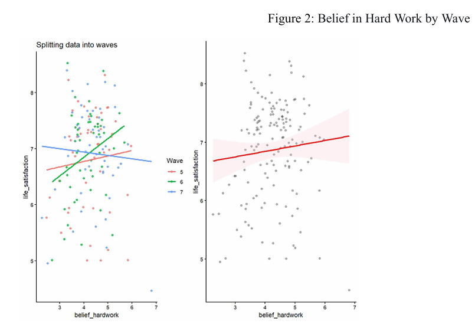

# econometrics
A panel study examining the relationship between the collective belief that success is achieved through hard work (rather than luck and connections) and the level of life satisfaction in the country, taking into account the macroeconomic context.
## Research question:
How does the belief that success can be achieved through hard work rather than luck  affect life satisfaction in a country? 

## Data
- WVS (waves 5–7, ≈2005–2022): life satisfaction, belief in hard work, sense of control over life.
- World Bank WDI: GDP per capita, Gini index, unemployment, spending on healthcare, education, employment in industry.
- The unit of analysis is “country × wave”: 50 countries × 3 waves = 150 observations. Balanced and unbalanced panels are constructed.

## Methodology
- Panel regression in three specifications: Pooled OLS, FE countries, FE countries and waves.
- Step‑by‑step addition of controls (models 1 → 1.3) to check the robustness of the effect.
- Testing hypotheses about the significance of coefficients, clustered errors, confidence intervals

## Results 
- Between countries (Pooled OLS), the relationship is insignificant.
- Within countries (FE), the effect is significant: a weakening of faith in work is associated with a decrease in satisfaction (β ≈ −0.208, p < 0.05).
- Unemployment has a consistent negative effect.
- The key factor is not faith in work, but the sense of personal control over life; the relationship is nonlinear.

